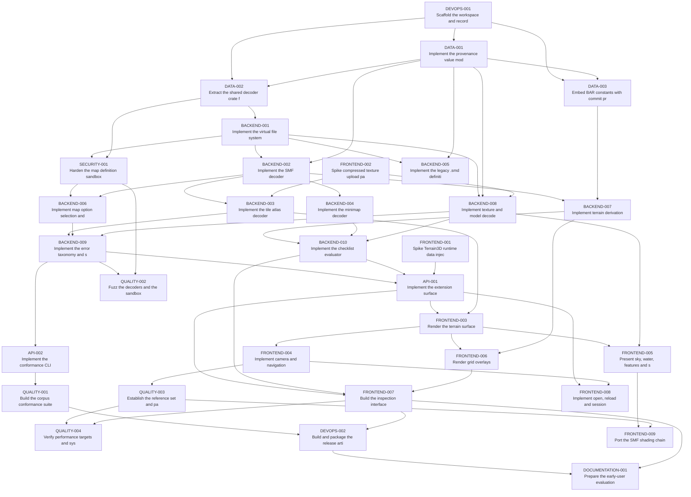

# P01 - Map Asset Exploration Task Summary

> **Phase:** P01
> **Acronym:** MAE
> **Directory:** `docs/requirements/phases/phase-01-map-asset-exploration/`
> **Progress:** 0/32 (0%)

Generated from the flat task files in this directory. `Dependents` are derived
from authored prerequisites, so the two directions cannot disagree.

## Ready Now

Tasks that are `Todo`, whose prerequisites are all `Done`, and which have no
unresolved external blocker.

- [P01-MAE-FRONTEND-001 - Spike Terrain3D runtime data injection and Rust interop](P01-MAE-FRONTEND-001-spike-terrain3d-runtime-injection.md) - `FRONTEND` · `P0` · `M`
- [P01-MAE-FRONTEND-002 - Spike compressed texture upload path](P01-MAE-FRONTEND-002-spike-compressed-texture-upload.md) - `FRONTEND` · `P0` · `S`
- [P01-MAE-DEVOPS-001 - Scaffold the workspace and record the licence](P01-MAE-DEVOPS-001-scaffold-workspace-and-licence.md) - `DEVOPS` · `P0` · `M`

All three are phase-start boundary tasks with no prerequisites. The two spikes
resolve ADR-01, ADR-02, ADR-03 and ADR-04, which the design validation named as
conditions on the phase; the workspace task records the licence that the phase
entry criteria require.

## In Progress

- None

## Blocked

29 tasks are `Todo` with prerequisites not yet `Done`. They are listed in the
Execution Order table below with their blocking prerequisites.

## Progress by Phase

| Phase | Total | Todo | In Progress | Blocked | Done | Cancelled |
|:---|---:|---:|---:|---:|---:|---:|
| P01 - Map Asset Exploration | 32 | 32 | 0 | 0 | 0 | 0 |

*Blocked is reported as 0 because no task is blocked by an unresolved external
blocker; tasks awaiting prerequisites remain `Todo` by the standard's status set.*

## Progress by Type

| Type | Total | Todo | In Progress | Blocked | Done | Cancelled |
|:---|---:|---:|---:|---:|---:|---:|
| API | 2 | 2 | 0 | 0 | 0 | 0 |
| BACKEND | 10 | 10 | 0 | 0 | 0 | 0 |
| DATA | 3 | 3 | 0 | 0 | 0 | 0 |
| DEVOPS | 2 | 2 | 0 | 0 | 0 | 0 |
| DOCUMENTATION | 1 | 1 | 0 | 0 | 0 | 0 |
| FRONTEND | 9 | 9 | 0 | 0 | 0 | 0 |
| QUALITY | 4 | 4 | 0 | 0 | 0 | 0 |
| SECURITY | 1 | 1 | 0 | 0 | 0 | 0 |
| **Total** | **32** | **32** | **0** | **0** | **0** | **0** |

## Execution Order

Ordered by dependency layer first, then priority, parent deliverable, type
continuity, estimate and ID. Dependencies override every display preference.

| Layer | Task | Parent Deliverable | Type | Priority | Estimate | Status | Prerequisites |
|---:|:---|:---|:---|:---|:---|:---|:---|
| 0 | [P01-MAE-FRONTEND-001](P01-MAE-FRONTEND-001-spike-terrain3d-runtime-injection.md) | `ADR-02` | `FRONTEND` | `P0` | `M` | `Todo` | None |
| 0 | [P01-MAE-FRONTEND-002](P01-MAE-FRONTEND-002-spike-compressed-texture-upload.md) | `ADR-03` | `FRONTEND` | `P0` | `S` | `Todo` | None |
| 0 | [P01-MAE-DEVOPS-001](P01-MAE-DEVOPS-001-scaffold-workspace-and-licence.md) | `NFR-PORT.1` | `DEVOPS` | `P0` | `M` | `Todo` | None |
| 1 | [P01-MAE-DATA-001](P01-MAE-DATA-001-implement-provenance-value-model.md) | `DATA-PROV.1` | `DATA` | `P0` | `M` | `Todo` | [P01-MAE-DEVOPS-001](P01-MAE-DEVOPS-001-scaffold-workspace-and-licence.md) |
| 2 | [P01-MAE-DATA-002](P01-MAE-DATA-002-extract-shared-decoder-crate.md) | `ADR-10` | `DATA` | `P0` | `L` | `Todo` | [P01-MAE-DEVOPS-001](P01-MAE-DEVOPS-001-scaffold-workspace-and-licence.md), [P01-MAE-DATA-001](P01-MAE-DATA-001-implement-provenance-value-model.md) |
| 2 | [P01-MAE-DATA-003](P01-MAE-DATA-003-embed-bar-constants-with-provenance.md) | `DATA-CONST.1` | `DATA` | `P1` | `S` | `Todo` | [P01-MAE-DEVOPS-001](P01-MAE-DEVOPS-001-scaffold-workspace-and-licence.md), [P01-MAE-DATA-001](P01-MAE-DATA-001-implement-provenance-value-model.md) |
| 3 | [P01-MAE-BACKEND-001](P01-MAE-BACKEND-001-implement-virtual-file-system.md) | `FR-READ.1` | `BACKEND` | `P0` | `M` | `Todo` | [P01-MAE-DATA-002](P01-MAE-DATA-002-extract-shared-decoder-crate.md) |
| 4 | [P01-MAE-BACKEND-002](P01-MAE-BACKEND-002-implement-smf-decoder.md) | `FR-READ.2` | `BACKEND` | `P0` | `L` | `Todo` | [P01-MAE-BACKEND-001](P01-MAE-BACKEND-001-implement-virtual-file-system.md), [P01-MAE-DATA-001](P01-MAE-DATA-001-implement-provenance-value-model.md) |
| 4 | [P01-MAE-SECURITY-001](P01-MAE-SECURITY-001-harden-map-definition-sandbox.md) | `NFR-SEC.1` | `SECURITY` | `P0` | `M` | `Todo` | [P01-MAE-BACKEND-001](P01-MAE-BACKEND-001-implement-virtual-file-system.md), [P01-MAE-DATA-002](P01-MAE-DATA-002-extract-shared-decoder-crate.md) |
| 4 | [P01-MAE-BACKEND-005](P01-MAE-BACKEND-005-implement-legacy-smd-parser.md) | `FR-READ.6` | `BACKEND` | `P1` | `S` | `Todo` | [P01-MAE-BACKEND-001](P01-MAE-BACKEND-001-implement-virtual-file-system.md), [P01-MAE-DATA-001](P01-MAE-DATA-001-implement-provenance-value-model.md) |
| 4 | [P01-MAE-BACKEND-008](P01-MAE-BACKEND-008-implement-texture-and-model-decoders.md) | `FR-SHOW.2` | `BACKEND` | `P1` | `L` | `Todo` | [P01-MAE-BACKEND-001](P01-MAE-BACKEND-001-implement-virtual-file-system.md), [P01-MAE-DATA-001](P01-MAE-DATA-001-implement-provenance-value-model.md), [P01-MAE-FRONTEND-002](P01-MAE-FRONTEND-002-spike-compressed-texture-upload.md) |
| 5 | [P01-MAE-BACKEND-003](P01-MAE-BACKEND-003-implement-tile-atlas-decoder.md) | `FR-READ.3` | `BACKEND` | `P0` | `L` | `Todo` | [P01-MAE-BACKEND-002](P01-MAE-BACKEND-002-implement-smf-decoder.md), [P01-MAE-FRONTEND-002](P01-MAE-FRONTEND-002-spike-compressed-texture-upload.md) |
| 5 | [P01-MAE-BACKEND-004](P01-MAE-BACKEND-004-implement-minimap-decoder.md) | `FR-READ.4` | `BACKEND` | `P1` | `S` | `Todo` | [P01-MAE-BACKEND-002](P01-MAE-BACKEND-002-implement-smf-decoder.md) |
| 5 | [P01-MAE-BACKEND-006](P01-MAE-BACKEND-006-implement-option-evaluation.md) | `FR-READ.7` | `BACKEND` | `P1` | `M` | `Todo` | [P01-MAE-SECURITY-001](P01-MAE-SECURITY-001-harden-map-definition-sandbox.md), [P01-MAE-BACKEND-002](P01-MAE-BACKEND-002-implement-smf-decoder.md) |
| 5 | [P01-MAE-BACKEND-007](P01-MAE-BACKEND-007-implement-terrain-derivation.md) | `FR-SHOW.10` | `BACKEND` | `P1` | `M` | `Todo` | [P01-MAE-BACKEND-002](P01-MAE-BACKEND-002-implement-smf-decoder.md), [P01-MAE-DATA-003](P01-MAE-DATA-003-embed-bar-constants-with-provenance.md) |
| 6 | [P01-MAE-BACKEND-009](P01-MAE-BACKEND-009-implement-error-taxonomy-and-staging.md) | `NFR-REL.1` | `BACKEND` | `P0` | `M` | `Todo` | [P01-MAE-BACKEND-003](P01-MAE-BACKEND-003-implement-tile-atlas-decoder.md), [P01-MAE-BACKEND-006](P01-MAE-BACKEND-006-implement-option-evaluation.md), [P01-MAE-BACKEND-008](P01-MAE-BACKEND-008-implement-texture-and-model-decoders.md) |
| 6 | [P01-MAE-BACKEND-010](P01-MAE-BACKEND-010-implement-checklist-evaluator.md) | `FR-CHECK.1` | `BACKEND` | `P1` | `L` | `Todo` | [P01-MAE-BACKEND-007](P01-MAE-BACKEND-007-implement-terrain-derivation.md), [P01-MAE-BACKEND-004](P01-MAE-BACKEND-004-implement-minimap-decoder.md), [P01-MAE-BACKEND-008](P01-MAE-BACKEND-008-implement-texture-and-model-decoders.md) |
| 7 | [P01-MAE-API-001](P01-MAE-API-001-implement-extension-surface.md) | `FR-SHOW.1` | `API` | `P0` | `L` | `Todo` | [P01-MAE-BACKEND-009](P01-MAE-BACKEND-009-implement-error-taxonomy-and-staging.md), [P01-MAE-BACKEND-010](P01-MAE-BACKEND-010-implement-checklist-evaluator.md), [P01-MAE-FRONTEND-001](P01-MAE-FRONTEND-001-spike-terrain3d-runtime-injection.md) |
| 7 | [P01-MAE-API-002](P01-MAE-API-002-implement-conformance-cli.md) | `FR-CONF.1` | `API` | `P1` | `M` | `Todo` | [P01-MAE-BACKEND-009](P01-MAE-BACKEND-009-implement-error-taxonomy-and-staging.md) |
| 7 | [P01-MAE-QUALITY-002](P01-MAE-QUALITY-002-fuzz-decoders-and-sandbox.md) | `NFR-REL.1` | `QUALITY` | `P1` | `M` | `Todo` | [P01-MAE-BACKEND-009](P01-MAE-BACKEND-009-implement-error-taxonomy-and-staging.md), [P01-MAE-SECURITY-001](P01-MAE-SECURITY-001-harden-map-definition-sandbox.md) |
| 8 | [P01-MAE-QUALITY-001](P01-MAE-QUALITY-001-build-corpus-conformance-suite.md) | `FR-CONF.1` | `QUALITY` | `P0` | `M` | `Todo` | [P01-MAE-API-002](P01-MAE-API-002-implement-conformance-cli.md) |
| 8 | [P01-MAE-FRONTEND-003](P01-MAE-FRONTEND-003-render-terrain-surface.md) | `FR-SHOW.1` | `FRONTEND` | `P0` | `L` | `Todo` | [P01-MAE-API-001](P01-MAE-API-001-implement-extension-surface.md), [P01-MAE-BACKEND-003](P01-MAE-BACKEND-003-implement-tile-atlas-decoder.md) |
| 9 | [P01-MAE-FRONTEND-004](P01-MAE-FRONTEND-004-implement-camera-and-navigation.md) | `FR-NAV.1` | `FRONTEND` | `P0` | `M` | `Todo` | [P01-MAE-FRONTEND-003](P01-MAE-FRONTEND-003-render-terrain-surface.md) |
| 9 | [P01-MAE-FRONTEND-006](P01-MAE-FRONTEND-006-render-grid-overlays.md) | `FR-SHOW.10` | `FRONTEND` | `P1` | `M` | `Todo` | [P01-MAE-FRONTEND-003](P01-MAE-FRONTEND-003-render-terrain-surface.md), [P01-MAE-BACKEND-007](P01-MAE-BACKEND-007-implement-terrain-derivation.md) |
| 9 | [P01-MAE-FRONTEND-005](P01-MAE-FRONTEND-005-present-scene-assets.md) | `FR-SHOW.4` | `FRONTEND` | `P1` | `L` | `Todo` | [P01-MAE-FRONTEND-003](P01-MAE-FRONTEND-003-render-terrain-surface.md), [P01-MAE-BACKEND-008](P01-MAE-BACKEND-008-implement-texture-and-model-decoders.md) |
| 10 | [P01-MAE-FRONTEND-007](P01-MAE-FRONTEND-007-build-inspection-interface.md) | `FR-CHECK.1` | `FRONTEND` | `P1` | `L` | `Todo` | [P01-MAE-API-001](P01-MAE-API-001-implement-extension-surface.md), [P01-MAE-BACKEND-010](P01-MAE-BACKEND-010-implement-checklist-evaluator.md), [P01-MAE-FRONTEND-006](P01-MAE-FRONTEND-006-render-grid-overlays.md) |
| 10 | [P01-MAE-QUALITY-003](P01-MAE-QUALITY-003-establish-reference-set-and-parity.md) | `FR-CONF.2` | `QUALITY` | `P1` | `M` | `Todo` | [P01-MAE-FRONTEND-004](P01-MAE-FRONTEND-004-implement-camera-and-navigation.md) |
| 10 | [P01-MAE-FRONTEND-008](P01-MAE-FRONTEND-008-implement-open-and-reload-flows.md) | `UX-OPEN.1` | `FRONTEND` | `P1` | `M` | `Todo` | [P01-MAE-API-001](P01-MAE-API-001-implement-extension-surface.md), [P01-MAE-FRONTEND-004](P01-MAE-FRONTEND-004-implement-camera-and-navigation.md) |
| 11 | [P01-MAE-QUALITY-004](P01-MAE-QUALITY-004-verify-performance-and-invariants.md) | `NFR-PERF.1` | `QUALITY` | `P1` | `M` | `Todo` | [P01-MAE-QUALITY-003](P01-MAE-QUALITY-003-establish-reference-set-and-parity.md), [P01-MAE-FRONTEND-007](P01-MAE-FRONTEND-007-build-inspection-interface.md) |
| 11 | [P01-MAE-DEVOPS-002](P01-MAE-DEVOPS-002-build-and-package-artifacts.md) | `NFR-PORT.1` | `DEVOPS` | `P1` | `M` | `Todo` | [P01-MAE-QUALITY-001](P01-MAE-QUALITY-001-build-corpus-conformance-suite.md), [P01-MAE-FRONTEND-007](P01-MAE-FRONTEND-007-build-inspection-interface.md) |
| 11 | [P01-MAE-FRONTEND-009](P01-MAE-FRONTEND-009-port-smf-shading-chain.md) | `NFR-FID.1` | `FRONTEND` | `P2` | `L` | `Todo` | [P01-MAE-FRONTEND-005](P01-MAE-FRONTEND-005-present-scene-assets.md), [P01-MAE-QUALITY-003](P01-MAE-QUALITY-003-establish-reference-set-and-parity.md) |
| 12 | [P01-MAE-DOCUMENTATION-001](P01-MAE-DOCUMENTATION-001-prepare-early-user-evaluation.md) | `BIZ-SAT.1` | `DOCUMENTATION` | `P1` | `S` | `Todo` | [P01-MAE-DEVOPS-002](P01-MAE-DEVOPS-002-build-and-package-artifacts.md), [P01-MAE-FRONTEND-007](P01-MAE-FRONTEND-007-build-inspection-interface.md) |

## Dependency Graph

## Critical Path

Longest dependency chain, weighted by estimate (`S`=1, `M`=3, `L`=5):

[P01-MAE-DEVOPS-001](P01-MAE-DEVOPS-001-scaffold-workspace-and-licence.md) → [P01-MAE-DATA-001](P01-MAE-DATA-001-implement-provenance-value-model.md) → [P01-MAE-DATA-002](P01-MAE-DATA-002-extract-shared-decoder-crate.md) → [P01-MAE-BACKEND-001](P01-MAE-BACKEND-001-implement-virtual-file-system.md) → [P01-MAE-BACKEND-002](P01-MAE-BACKEND-002-implement-smf-decoder.md) → [P01-MAE-BACKEND-003](P01-MAE-BACKEND-003-implement-tile-atlas-decoder.md) → [P01-MAE-BACKEND-009](P01-MAE-BACKEND-009-implement-error-taxonomy-and-staging.md) → [P01-MAE-API-001](P01-MAE-API-001-implement-extension-surface.md) → [P01-MAE-FRONTEND-003](P01-MAE-FRONTEND-003-render-terrain-surface.md) → [P01-MAE-FRONTEND-006](P01-MAE-FRONTEND-006-render-grid-overlays.md) → [P01-MAE-FRONTEND-007](P01-MAE-FRONTEND-007-build-inspection-interface.md) → [P01-MAE-DEVOPS-002](P01-MAE-DEVOPS-002-build-and-package-artifacts.md) → [P01-MAE-DOCUMENTATION-001](P01-MAE-DOCUMENTATION-001-prepare-early-user-evaluation.md)

**Total estimated effort along the path: 49 points across 13 tasks.**

The path runs from the workspace through the shared decoder crate and the whole
decode pipeline into the extension bridge and the interface, which matches the
intent record's accepted decision to build in strict dependency order - decoder
complete and correct before anything renders.

## Traceability Gaps

**None.** Graph validation passes:

- 32 flat task files, each appearing exactly once; no subdirectories
- All IDs and filenames unique and consistent with their headings
- All prerequisites resolve to real tasks; no cycles
- Dependents are exactly the reverse of authored prerequisites
- No cross-phase edges exist - P01 has no prerequisite phases
- Every acceptance criterion has a verification command and expected result
- Dangling tasks are limited to documented phase-start and phase-end boundaries

### Coverage

Every P01 product requirement traces to at least one task, and every task traces
back to business requirements, product requirements and the technical design.
Requirements deliberately not translated into tasks are the governance
obligations recorded in the product requirements readiness analysis
(`COMP-LICENSE.1` is covered by [P01-MAE-DEVOPS-001](P01-MAE-DEVOPS-001-scaffold-workspace-and-licence.md);
`GUARD-SCOPE.1` and `GUARD-SCOPE.4` govern requirement admission rather than product behaviour).

## Completed

- None. No task has been executed yet.

## Cancelled

- None.

