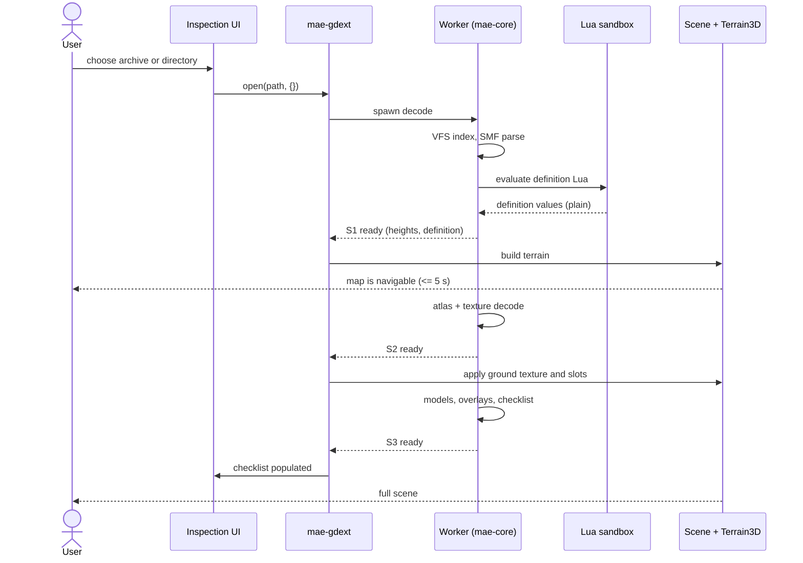
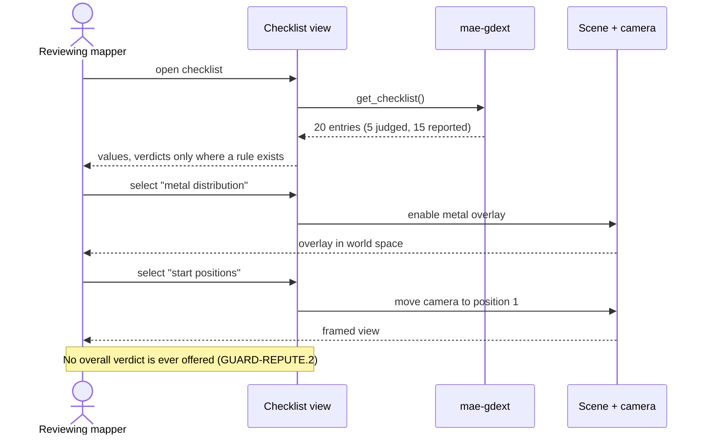
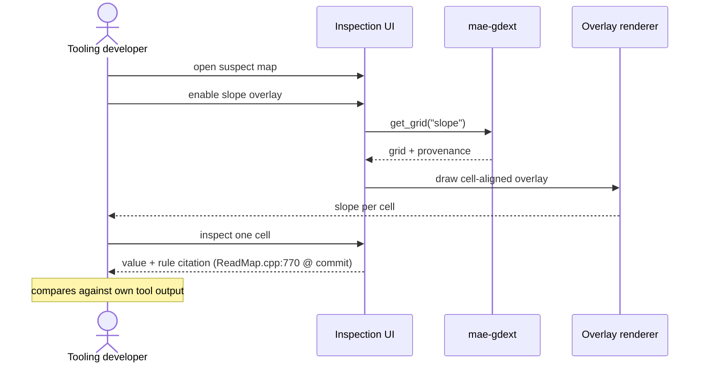
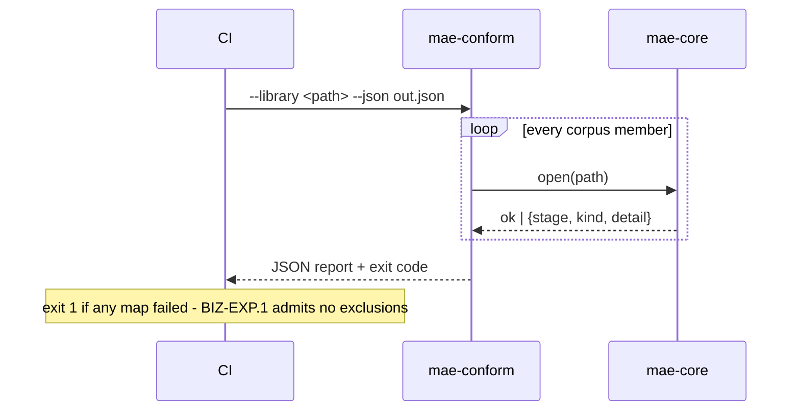
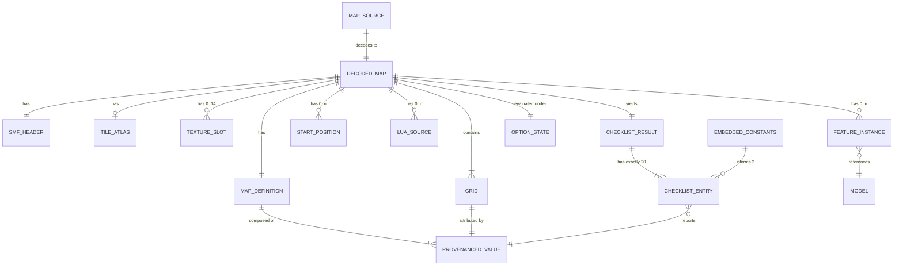
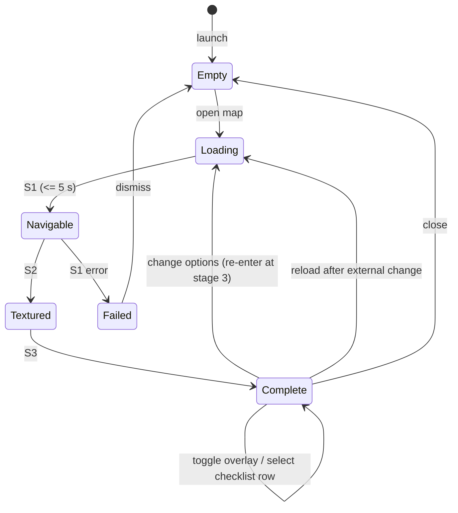
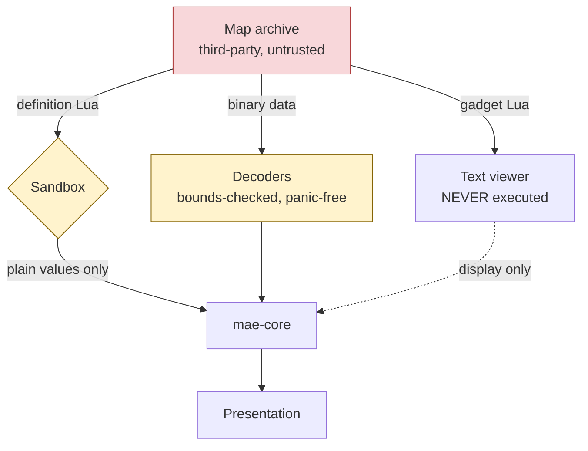

# Information Architecture: P01 - Map Asset Exploration (MAE)

**Phase-local documents.** Business requirements:
[`business-requirements.md`](../business-requirements/business-requirements.md).
Product requirements:
[`product-requirements.md`](../product-requirements/product-requirements.md).
Technical design: [`technical-design.md`](technical-design.md).

This document defines **boundaries, not internals**. Where the TDD specifies the
provenance type and the SMF layout, this one shows how the pieces compose.

---

## 1. System Overview

**One line.** A binary Beyond All Reason map file becomes an explorable,
inspectable three-dimensional scene in which every displayed value knows where
it came from.

```mermaid
graph LR
    subgraph input["INPUT - untrusted, read-only"]
        A[".sd7 archive<br/>or map directory"]
    end
    subgraph decode["DECODE - Rust, off the main thread"]
        B["Read<br/>VFS"] --> C["Parse<br/>SMF · SMT · TDF"]
        C --> D["Evaluate<br/>sandboxed Lua"]
        D --> E["Derive<br/>slope · passability · metal"]
        E --> F["Attribute<br/>provenance on every value"]
    end
    subgraph present["PRESENT - Godot, main thread"]
        G["Terrain + assets"] --> H["Explore<br/>camera · overlays"]
        H --> I["Verify<br/>checklist view"]
    end
    A --> B
    F -->|"plain data<br/>via deferred call"| G

    classDef untrusted fill:#f8d7da,stroke:#a33
    classDef rust fill:#dea584,stroke:#8b4513
    classDef godot fill:#b3d4e8,stroke:#33629b
    class input untrusted
    class decode rust
    class present godot
```



### Architectural contracts

Invariants governing the whole system. Each is testable.

1. **The presentation layer never reads a file.** Only `mae-core` touches the
   filesystem. Godot has no path to map data except through the extension.
2. **`mae-core` never names a Godot type.** Enforced by its dependency
   manifest; this is what makes the thread boundary structural rather than
   disciplinary.
3. **No component ever opens a map file for writing.** (`NFR-VALID.2`)
4. **Map Lua executes only inside the sandbox, and only definition Lua.** Gadget
   Lua is text. (`NFR-SEC.1`, `NFR-VALID.3`)
5. **No value crosses into the presentation layer without provenance.**
   (`DATA-PROV.1`)
6. **Nothing leaves the machine.** No network call exists in any component.
7. **`mae-conform` reaches the same verdict as `mae-app`**, because both use the
   same `mae-core`. A map that opens in one opens in the other.

---

## 2. Core Design Principles

> **Principle: Provenance is inseparable from value**
> **Rule:** Any value that can reach a user is wrapped with its origin - a rule
> citation, an unknown reason, or an absence marker. There is no API to obtain a
> bare displayable value.
> **Violation example:** A function returns `f32` for map hardness and the caller
> formats it for display. The number is now indistinguishable from a guess, and
> `GUARD-ACC.1` is broken in a way no test would catch.

> **Principle: The core is engine-free**
> **Rule:** `mae-core` compiles, tests and runs the whole corpus without Godot
> present.
> **Violation example:** A decoder returns `godot::Image` "to save a conversion".
> `mae-conform` now needs a rendering environment, the clean-machine test for
> `NFR-DEP.1` becomes impossible, and worker threads gain the ability to touch
> Godot objects.

> **Principle: Absent, unknown and wrong are three different things**
> **Rule:** Every asset and value distinguishes legitimately-missing from
> could-not-be-derived. Neither is an error.
> **Violation example:** A map with no skybox reports an error. 166 of 255 corpus
> members would fail, breaching `BIZ-EXP.1`, over a condition that is normal.

> **Principle: The tool reports; the reviewer decides**
> **Rule:** A pass or fail appears only where the published checklist states a
> numeric rule - exactly five of twenty properties. Everything else is a value.
> **Violation example:** The checklist view shows a green tick for "splat
> distribution balanced". The tool has invented a judgement the checklist does
> not define, and a reviewer may approve a map on it. (`GUARD-REPUTE.2`)

> **Principle: Untrusted input stays contained**
> **Rule:** Map Lua runs with a whitelist, an instruction ceiling and a memory
> ceiling. Widening any of the three is a reviewed decision.
> **Violation example:** `os.time` is added to the whitelist "because a map needs
> it". The whitelist has become a blacklist by increments.

---

## 3. Data Flow Pipeline

### Stage map

| Stage | Input | Processing | Output | Components | PRD trace |
|:---|:---|:---|:---|:---|:---|
| **1. Access** | Path to archive or directory | Open, index entries, case-insensitive lookup | Readable entry set | VFS | `FR-READ.1` |
| **2. Parse** | Entry bytes | SMF header and grids; SMT atlas; minimap; `.smd` where needed | Raw grids and headers | SMF/SMT/minimap/TDF decoders | `FR-READ.2`, `.3`, `.4`, `.6` |
| **3. Evaluate** | Definition Lua and overlays, selected options | Sandboxed Lua 5.1 with VFS shim; key lowercasing | Map definition values | Definition evaluator | `FR-READ.5`, `.7` |
| **4. Derive** | Grids + definition + embedded constants | Slope, passability per movement class, metal spots, depth bands | Derived terrain facts | Terrain deriver | `FR-SHOW.10`, `FR-CHECK.4` |
| **5. Attribute** | All values from stages 2-4 | Wrap each as derived-with-citation, unknown, or absent | `DecodedMap` | Provenance model | `DATA-PROV.1`, `FR-SHOW.11` |
| **6. Decode media** | Texture and model entries | DDS/TGA/BMP decode; S3O parse | GPU-ready images, meshes | Texture decoder, model loader | `FR-SHOW.2`, `.3`, `.6` |
| **7. Evaluate checklist** | `DecodedMap` | Compute 20 properties; judge exactly 5 | `ChecklistResult` | Checklist evaluator | `FR-CHECK.1`, `.2` |
| **8. Publish** | Stage outputs | Marshal plain data across the extension boundary via deferred call | Godot-side resources | `mae-gdext` | `NFR-PERF.3` |
| **9. Present** | Godot resources | Terrain, sky, water, features, overlays, markers | Rendered scene | Scene presenter, Terrain3D | `FR-SHOW.1`, `.4`, `.5`, `.7`, `.8` |
| **10. Explore** | Rendered scene + user input | Ground-anchored camera, altitude-scaled speed, overlays, checklist links | Interaction | Camera controller, Inspection UI | `FR-NAV.*`, `FR-CHECK.3` |

### Stage transitions and exit criteria

Publication is **staged**, not monolithic - `NFR-PERF.3` allows no UI block
beyond one second.

| Publication stage | Contains | Exit criterion | Budget |
|:---|:---|:---|:---|
| **S1 - Navigable** | Stages 1-3 plus terrain mesh | Heightmap parsed, definition evaluated, mesh built. **The user can fly.** | <= 5 s |
| **S2 - Appearance** | Stage 6 textures and atlas | Ground texture and shading slots applied | <= 20 s |
| **S3 - Complete** | Stages 4, 7, models, overlays | Checklist populated, features placed, overlays available | Best effort |

**Transition rules.** S1 is blocking - nothing is shown before it. S2 and S3
arrive asynchronously and update the scene in place. A failure in S2 or S3
**degrades that stage only**; the map stays open and reports what failed
(`NFR-REL.1`). A failure in S1 means the map did not open, which under
`BIZ-EXP.1` is a phase-blocking defect.

**Option change** re-enters at stage 3 and re-runs 3-7; stages 1-2 are not
repeated because the file has not changed (`FR-READ.7`).

**External file change** re-enters at stage 1 (`UX-RELOAD.1`).

---

## 4. Interaction Architecture

### Communication topology

| From → To | Mechanism | Pattern | Budget |
|:---|:---|:---|:---|
| Inspection UI → `mae-gdext` | GDExtension method call | Request/response | Non-blocking; returns staged state |
| Scene presenter → `mae-gdext` | GDExtension method call | Request/response | Per-frame reads must be O(1) |
| `mae-gdext` → `mae-core` | Direct Rust call | Request/response | In-process |
| `mae-core` worker → main thread | Channel + `call_deferred` | Async completion | Drained once per frame |
| Scene presenter → Terrain3D glue | GDScript call | Request/response | Untyped by necessity |
| Terrain3D glue → Terrain3D | Dynamic call | Request/response | No typed API exists |
| `mae-conform` → `mae-core` | Direct Rust call | Batch | Headless, no Godot |
| VFS → filesystem | File read | **Read only** | - |

**No pair in this system communicates over a network.** There is no gateway, no
queue, no broker and no service mesh, because there is one process.

### Journey 1 - Opening and exploring a map (P-REV, P-AUT)



### Journey 2 - Verifying against the checklist (P-REV)



### Journey 3 - Verifying a derived fact (P-TOOL)



### Journey 4 - Conformance run (project owner)



### Context accumulation

The system holds one map at a time. State is: the `DecodedMap` in `mae-core`,
the Godot scene derived from it, and UI selections. Opening another map releases
the previous one. **Eviction policy:** one map resident; the in-memory reuse
cache (ADR-11) keeps at most the most recently closed map, keyed by path and
modification time, and is dropped on memory pressure.

---

## 5. Data Architecture

### Entity relationships



**Cardinality worth noting.** `CHECKLIST_RESULT` has **exactly** twenty
entries, always, for every map - a missing property is an entry in the `absent`
or `unknown` state, never a shorter list. `TEXTURE_SLOT` is 0..14 because ten
shading slots plus four override grids are each independently optional, which
the corpus proves is the normal case.

### Store map

| Store | Purpose | Technology | Key entities | Size | Trace |
|:---|:---|:---|:---|:---|:---|
| Process memory | The open map and its provenance | Rust heap | `DecodedMap`, `Provenanced<T>` | Measured per `NFR-PERF.4` | `DATA-MAP.1`, `DATA-PROV.1` |
| Compiled binary | BAR constants with source commit | Rust static data | `EMBEDDED_CONSTANTS` | Tens of values | `DATA-CONST.1` |
| Repository files | Parity captures, camera positions, timings | PNG + JSON | `REFERENCE_SET` | 6-10 maps | `DATA-REF.1` |
| Local config file | Window layout, last map, selections | JSON | `SESSION_STATE` | Kilobytes | `DATA-SESS.1` |
| Run output file | Per-map conformance results | JSON | `CONFORMANCE_RESULT` | One row per member | `FR-CONF.1` |

**There is no database, and introducing one is an "ask first" action.**

### Persistence strategy

| Data type | Primary store | Cache | Lifecycle | TTL | Retention |
|:---|:---|:---|:---|:---|:---|
| Decoded map | Process memory | Most-recent-closed, keyed by path + mtime | Open → closed → dropped | Session | None |
| Provenance | Inside each value | - | With its value | Session | None |
| Embedded constants | Binary | - | Build → release | - | Life of build |
| Reference captures | Repository | - | Captured → superseded on engine commit change | - | Versioned |
| Session state | Local file | - | Written on change | - | Until user clears |
| Conformance results | Output file | - | Written per run | - | Per CI policy |
| **Map files** | **User's filesystem** | - | **Read only, never written** | - | **Untouched** |

**Caching.** One layer only: the most recently closed `DecodedMap`, invalidated
by modification time or explicit reload. No disk cache (ADR-11), no CDN, no
distributed cache - none of which has a subject in this system.

---

## 6. UI Interaction Model

### Screen zones

```
┌─────────────────────────────────────────────────────────────┐
│ [Open…]  map name · source: archive | directory   [Options▾]│  Command bar
├──────────────┬──────────────────────────────────┬───────────┤
│              │                                  │           │
│  Asset       │                                  │ Checklist │
│  inventory   │        3D viewport               │ 20 rows   │
│              │                                  │ 5 judged  │
│ terrain  ✓   │   terrain · sky · water          │ 15 values │
│ atlas    ✓   │   features · markers · overlays  │           │
│ sky      —   │                                  │ select a  │
│ features ✓   │                                  │ row → cam │
│ normal   ?   │                                  │ or overlay│
│ …            │                                  │           │
├──────────────┴──────────────────────────────────┴───────────┤
│ Overlays: [metal][type][slope][pathability][grass]  stage 3/3│  Status bar
└─────────────────────────────────────────────────────────────┘

Legend:  ✓ present    — absent (normal)    ? unknown (could not derive)
```

Three states carry a **glyph as well as colour**, satisfying `NFR-A11Y.1` and
making `FR-SHOW.11` visible at a glance rather than on inspection.

### Navigation flow



**There is no modal blocking state.** `Loading` is navigable from S1 onward,
which is what `NFR-PERF.3` requires.

### Interaction patterns

- **Primary input:** mouse for camera; keyboard `WASD`/`QE` for movement;
  clicks for overlays and checklist rows.
- **Progressive disclosure:** the viewport is the default surface; asset
  inventory and checklist are panels that can be collapsed.
- **Feedback:** stage indicator in the status bar; per-asset state in the
  inventory; provenance on hover for any displayed value.
- **Keyboard operability:** every checklist action reachable without a mouse
  (`NFR-A11Y.1`).

### State management

| State | Lives in | Synchronises with |
|:---|:---|:---|
| Camera position and mode | Godot scene | Nothing - view only |
| Overlay selection | Inspection UI | Scene presenter |
| Option selection | UI, authoritative in `mae-core` | Triggers re-entry at stage 3 |
| Decoded map | `mae-core` | Published to Godot in stages |
| Panel layout, last map | Session file | Written on change |

---

## 7. Service Architecture

There are no services in the networked sense. The equivalent catalogue is of
deployable units and libraries.

| Unit | Responsibility | Stack | Interfaces | Scaling |
|:---|:---|:---|:---|:---|
| `mae-app` | Present and explore a map | Godot 4.4+ | GDExtension calls in; user input | Single process |
| `mae-gdext` | Marshal between Godot and the core | Rust, gdext | Godot API; direct Rust calls | Same process |
| `mae-core` | Read, decode, evaluate, derive, attribute | Rust, no Godot | Rust API; filesystem reads | Worker threads = cores - 1 |
| `mae-conform` | Verify a whole library headlessly | Rust binary | CLI; exit code; JSON | Parallel over maps |
| `mae-reference` | Capture parity images and timings | Godot headless | CLI | Run rarely |
| Terrain3D | Clipmap mesh and LOD | C++ GDExtension, MIT | Dynamic calls via glue | Within the app |

### Resilience per unit

| Unit | Failure mode | Behaviour |
|:---|:---|:---|
| `mae-core` | Decode failure at any stage | Typed error naming the stage; no panic; caller decides |
| `mae-core` | Map Lua runaway | Instruction or memory ceiling terminates evaluation; value becomes unknown; map still opens |
| `mae-gdext` | Worker result arrives after map closed | Discarded; no Godot object touched off-thread |
| `mae-app` | S2 or S3 failure | Scene degrades to the last good stage; asset marked failed |
| `mae-app` | Terrain3D unavailable | Startup failure with a named cause, not a silent blank viewport |
| `mae-conform` | Any map fails | Recorded and run continues unless `--fail-fast`; exit code 1 |
| `mae-gdext` | `gdext` breaking change on upgrade | Pinned release; upgrade is a deliberate work item gated by the conformance run |
| `mae-app` | Godot or driver fault | `mae-conform` still verifies decode correctness without Godot, so a rendering fault never masks a decode regression |
| `mae-core` | File removed or modified mid-read | Typed `vfs` stage error; the previous view is retained rather than discarded |

**Circuit breakers, retries and dead-letter queues are deliberately absent.**
They protect against unreliable remote dependencies. Every dependency here is a
local file or an in-process library, and retrying a malformed file yields the
same malformed file.

**Health checks** are not applicable - there is no orchestrator and no
long-running service to probe.

### Configuration

| Setting | Mechanism | Default |
|:---|:---|:---|
| Map library path | CLI argument or UI | Standard BAR install path |
| Worker thread count | Config file | Available parallelism - 1 |
| Lua instruction ceiling | Config file | Calibrated against the corpus |
| Lua memory ceiling | Config file | Calibrated against the corpus |
| Stage timeout budgets | Config file | S1 5 s, S2 20 s |

No feature flags, no remote configuration, no environment progression.

---

## 8. Security Boundaries

### The single boundary



**Authentication: none exists.** No accounts, no login, no tokens, no sessions
in the security sense. There is nothing to authenticate to.

**Authorization: none exists.** One local user with the privileges of their own
operating system account. No roles, no permission matrix.

Both are stated rather than omitted, so a reader does not conclude they were
forgotten.

### What the sandbox denies

| Capability | Mechanism | Rationale |
|:---|:---|:---|
| Filesystem | Whitelist globals; VFS shim exposes only archive contents | Map Lua must read overlays, nothing else |
| Network | No networking library in the environment | Nothing in a map needs it |
| Process creation | `os.execute` and equivalents absent from the whitelist | Nothing in a map needs it |
| Unbounded execution | Instruction-count hook + memory ceiling | **A separate axis from capability** - the one blocking globals does not solve |

**Escalation path on violation:** evaluation terminates, dependent values become
`Unknown` with a reason, the map still opens, and the event is logged. A
sandbox escape is a P0 defect.

### Data privacy

| Classification | Present? |
|:---|:---|
| Personal data | **None anywhere in the system** |
| Financial or health data | None |
| Credentials or secrets | None |
| Third-party creative content | Yes - map archives. Read and displayed, **never redistributed** (`COMP-CONTENT.1`) |

**Consent model:** not applicable - no data is collected.
**Erasure lifecycle:** not applicable - nothing personal is stored. Session
state contains local file paths only and is deletable by removing one file.
**Audit logging:** not applicable in the compliance sense. Diagnostic logs are
local, contain map paths and decode outcomes, and are never transmitted.

---

## 9. Cross-Cutting Concerns

### Content safety

No user-generated content is published, shared or transmitted. Map archives are
third-party content displayed locally to the person who supplied them. There is
no moderation surface because there is no distribution surface.

### Rate limiting

Not applicable. No API, no network, no multi-tenancy, no shared resource to
protect. The equivalent resource protections are internal: the Lua instruction
and memory ceilings, and the worker thread cap.

### Session continuity

No network session exists, so there is no reconnection behaviour. Continuity
means: window layout, last-opened map and panel selections are restored on
launch (`DATA-SESS.1`). If the previously opened map has moved or changed, the
application opens empty rather than failing.

### Accessibility

Target: WCAG 2.2 AA as a **quality target**, not a compliance obligation - no
statutory regime applies and no `COMP-*` requirement mandates a level.
Applicable subset for a desktop 3D tool:

- Every checklist action reachable by keyboard (`NFR-A11Y.1`).
- The three provenance states carry a glyph as well as colour; likewise pass and
  fail.
- Sufficient contrast in the checklist and inventory panels.
- The 3D viewport is inherently visual; the checklist view is the accessible
  path to the same facts, which is a deliberate part of its value.

### Observability

| Concern | Approach |
|:---|:---|
| Logging | Structured local log; decode stage, map identity, outcome, duration. Never transmitted |
| Correlation | One map open at a time; the map path is the correlation key |
| Metrics | None collected or exported. Performance is measured in the reference run, not in production |
| Tracing | Not applicable - single process, no distributed calls |
| Alerting | Not applicable - no running service. The CI conformance run is the equivalent signal, and its exit code is the alert |

**Telemetry is deliberately absent.** The product is offline and collects
nothing. This is recorded here because adding observability tooling is a reflex
that would contradict the product's shape and its users' expectations.

---

## 10. Quality Gates

| Gate | Status |
| --- | --- |
| Every data flow stage traces to a PRD requirement | Met - 10 stages, each with a trace |
| Every service and store named with its purpose | Met - 6 units, 5 stores |
| Communication protocols defined for all component pairs | Met - 8 pairs; absence of network protocols stated explicitly |
| Persistence strategy covers every data type with retention | Met - 7 rows including map files as explicitly never written |
| Security boundaries explicit | Met - one real boundary detailed; auth and authz stated as non-existent rather than omitted |
| At least one sequence diagram per primary journey | Met - 4 journeys, 4 diagrams |
| No internal implementation details | Met - schemas and algorithms stay in the TDD; this document stops at boundaries |
| Cross-cutting concerns addressed | Met - 6 areas, each either designed or marked inapplicable with a reason |
| Diagrams text-renderable | Met - Mermaid throughout, plus one ASCII layout |
| Covers only the selected phase, links phase-local documents | Met - P01 only; BRD, PRD and TDD linked at the head |
