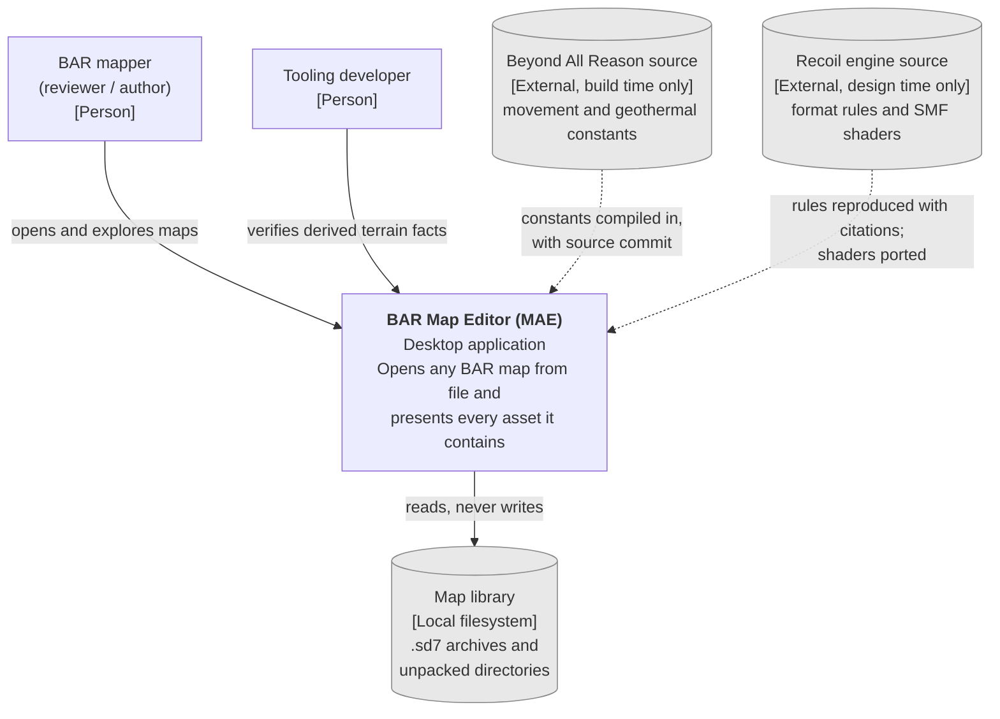
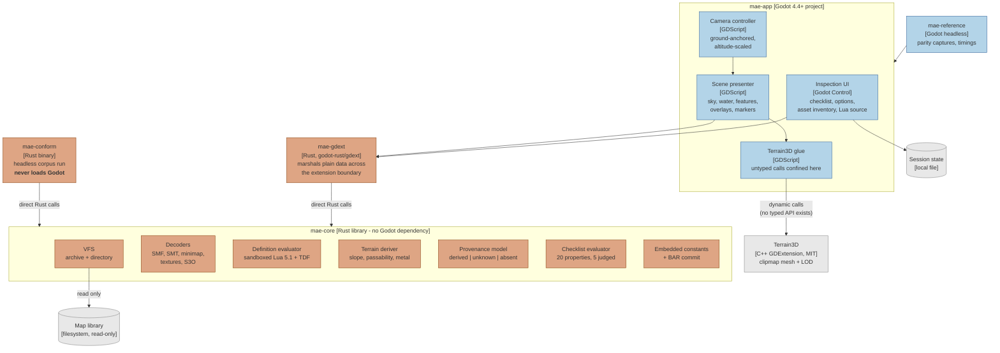
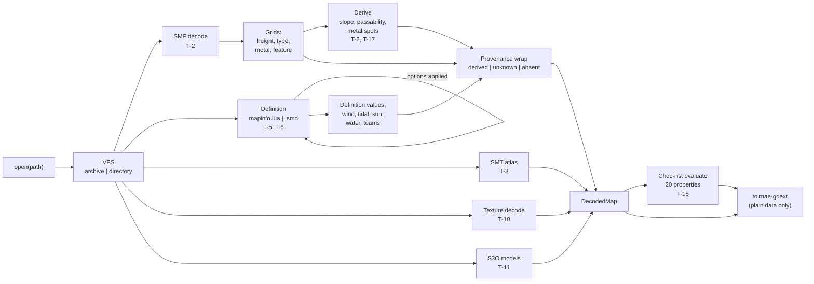
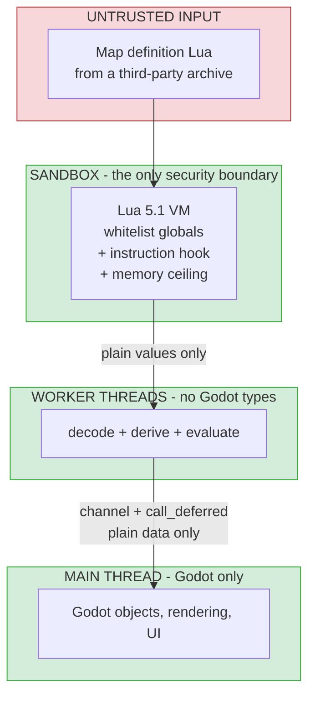

# Technical Design Document: P01 - Map Asset Exploration (MAE)

## Extended Table of Contents

- **§1 Background** - a standalone Godot desktop application that opens any
  Beyond All Reason map from file and presents every asset it contains, with a
  Rust decoding core that never depends on the game or engine at runtime.
- **§2 Requirements** - 28 FRs and 15 NFRs from the P01 PRD, restated as
  technical behaviours and measurable targets.
- **§3 Architecture** - 5 owned containers plus 2 external, in a
  core-library-and-shell topology; C4 context, container and two component
  diagrams.
- **§4 Data design** - no database. In-memory decoded map with pervasive
  per-value provenance; four small file-backed artifacts.
- **§5 Interfaces** - no network API. One extension surface, one checklist
  schema, one CLI contract, one capture manifest, a versioning policy, and one
  thread-crossing contract.
- **§6 Infrastructure** - desktop distribution, two artifacts per platform,
  conformance run as the CI gate. No servers, no telemetry.
- **§7 Failure modes** - 11 FMEA entries; highest RPN 168 (constant staleness).
  No RPO or RTO - there is no service to recover.
- **§8 Alternatives** - 13 ADRs with full trade-off analysis.

---

## 1. Background & Traceability

**Phase:** `P01` - Map Asset Exploration (`MAE`)
**Directory:** `docs/requirements/phases/phase-01-map-asset-exploration/`
**Prerequisite phases:** None. P01 is the first registry entry.
**Downstream:** P02 - Map Write Round Trip (`MWRT`) depends on this phase.

**Primary product requirements implemented**

- *Decode pipeline:* `FR-READ.1` to `FR-READ.8`
- *Presentation:* `FR-SHOW.1` to `FR-SHOW.11`
- *Navigation:* `FR-NAV.1` to `FR-NAV.3`
- *Verification:* `FR-CHECK.1` to `FR-CHECK.4`, `FR-CONF.1`, `FR-CONF.2`
- *Qualities:* `NFR-PERF.1` to `.4`, `NFR-PORT.1`, `NFR-DEP.1`, `NFR-SEC.1`,
  `NFR-REL.1`, `NFR-VALID.1` to `.3`, `NFR-LIC.1`, `.2`, `NFR-A11Y.1`,
  `NFR-FID.1`
- *Data:* `DATA-PROV.1`, `DATA-MAP.1`, `DATA-CONST.1`, `DATA-REF.1`,
  `DATA-SESS.1`

**Parent business requirements:** `BIZ-EXP.1` to `.4`, `BIZ-EFF.1`, `BIZ-SAT.1`,
`MARK-DIFF.1`, `MARK-PARITY.1`, `OPER-WORKFLOW.1` to `.4`, `OPER-MIGRATE.1`,
`OPER-SCALE.1`, `OPER-REPORT.1`, `.2`, `COMP-LICENSE.1`, `.2`,
`COMP-CONTENT.1`, `GUARD-ACC.1`, `GUARD-REPUTE.1`, `.2`, `GUARD-SCOPE.1` to `.5`.

**Context.** Beyond All Reason's map toolchain is one-way: authors compile
images into a binary map, and seeing the result means launching the game. Two
volunteer reviewers must verify twenty published checklist properties per map
with no tool that surfaces them. This phase builds the reader.

**Technical goals**

1. Decode every corpus map correctly, with no exclusions and no crashes.
2. Carry provenance on every value, so nothing displayed is ever a guess.
3. Present the map fast enough to beat launching the game.
4. Depend on no engine, no game installation, and no network at runtime.

**Non-goals**

- **No writing of map data.** Architecturally prohibited (`NFR-VALID.2`);
  belongs to P02.
- **No execution of map gadget Lua** (`NFR-VALID.3`); map definition Lua only,
  sandboxed.
- **No database, no server, no telemetry, no accounts.** None is needed, and
  each would contradict `NFR-DEP.1` or the product's offline shape.
- **No generalisation beyond Recoil's formats** (`GUARD-SCOPE.1`).

---

## 2. Requirements Breakdown

### 2.1 Functional requirements, in technical terms

| # | Technical behaviour | Traces to |
|:---|:---|:---|
| T-1 | Expose a uniform read interface over a 7-Zip archive and a filesystem directory, with case-insensitive path lookup | `FR-READ.1` |
| T-2 | Parse the SMF header and extract heightmap, typemap, metalmap, feature block and vegetation extra-header; decode heights as `min + raw * (max - min) / 65536` | `FR-READ.2` |
| T-3 | Parse the SMT tile file set, honouring the declared tile-file count, and resolve the `mapx/4 * mapy/4` tile index grid | `FR-READ.3` |
| T-4 | Decode the 699048-byte, 9-mip DXT1 minimap block | `FR-READ.4` |
| T-5 | Evaluate map definition Lua in a sandbox with a VFS shim, lowercasing keys on lookup as `LuaParser.cpp` does | `FR-READ.5`, `NFR-SEC.1` |
| T-6 | Parse the legacy TDF `.smd` definition when `mapinfo.lua` is absent | `FR-READ.6` |
| T-7 | Re-evaluate the definition and all derived values on map-option change | `FR-READ.7` |
| T-8 | Represent every asset as present, absent or unknown, distinctly | `FR-READ.8`, `DATA-PROV.1` |
| T-9 | Build a clipmap terrain surface from the heightmap and apply the resolved ground texture | `FR-SHOW.1` |
| T-10 | Decode and upload ten shading texture slots plus four override grids | `FR-SHOW.2`, `FR-SHOW.3` |
| T-11 | Present sky, water, S3O feature instances, start positions and map-side Lua source | `FR-SHOW.4` to `.9` |
| T-12 | Render five toggleable world-space grid overlays, cell-aligned | `FR-SHOW.10` |
| T-13 | Display every value with its provenance state, distinguished by a non-colour attribute | `FR-SHOW.11`, `NFR-A11Y.1` |
| T-14 | Ground-anchored camera with altitude-scaled speed and named positions | `FR-NAV.1` to `.3` |
| T-15 | Compute all twenty checklist properties; judge exactly the five with numeric rules | `FR-CHECK.1`, `.2` |
| T-16 | Link spatial checklist properties to an overlay or camera position | `FR-CHECK.3` |
| T-17 | Derive pathability and geovent buildability from compiled-in constants carrying a BAR commit | `FR-CHECK.4`, `DATA-CONST.1` |
| T-18 | Run non-interactively over a map library, returning per-map pass or fail and a non-zero exit code on any failure | `FR-CONF.1` |
| T-19 | Capture parity screenshots and traversal timings against a pinned engine commit | `FR-CONF.2`, `DATA-REF.1` |

### 2.2 Non-functional targets

| # | Target | Traces to |
|:---|:---|:---|
| N-1 (Frame rate) | 60 fps sustained during traversal; 1% low >= 45 fps; **never below 30 fps** | `NFR-PERF.1` |
| N-2 (Traversal) | Corner-to-corner time <= the same traversal in Beyond All Reason at the pinned commit, on every reference-set map | `NFR-PERF.2` |
| N-3 (Staged load) | Terrain navigable within 5 s; all textures within 20 s; no UI block > 1 s | `NFR-PERF.3` |
| N-4 (Memory) | Peak measured per reference-set map; largest archive <= 2x reference median; **never exhausts memory** | `NFR-PERF.4` |
| N-5 (Portability) | Conformance run passes on Windows and Linux with identical per-map results | `NFR-PORT.1` |
| N-6 (Independence) | Opens a map on a machine with no BAR installation and no running engine | `NFR-DEP.1` |
| N-7 (Security) | Sandbox denies filesystem, network, process creation and unbounded execution | `NFR-SEC.1` |
| N-8 (Reliability) | Zero crashes across a full conformance run, including corrupted input | `NFR-REL.1` |
| N-9 (Honesty) | Every displayed value is derived-with-citation, unknown, or absent; zero substituted defaults | `NFR-VALID.1` |
| N-10 (Read-only) | No write path to any map file exists in the codebase | `NFR-VALID.2` |
| N-11 (Licensing) | Dependency attribution in every distributed build; no map content shipped | `NFR-LIC.1`, `.2` |
| N-12 (Accessibility) | Checklist view keyboard-operable; no information by colour alone | `NFR-A11Y.1` |
| N-13 (Fidelity, P2) | Side-by-side captures indistinguishable at the pinned commit | `NFR-FID.1` |

---

## 3. Architecture & Diagrams

### 3.1 Level 1 - System context



**Legend.** Solid arrows are runtime interactions; dotted arrows are
design-time or build-time only and carry **no runtime dependency** - this is
`NFR-DEP.1` made visible. There is no network, no server and no external
service anywhere in the context.

### 3.2 Level 2 - Container diagram (primary)



**Container responsibilities and traceability**

| Container | Technology | Implements | Why it is separate |
|:---|:---|:---|:---|
| `mae-core` | Rust library (`rlib` + `cdylib`) | `FR-READ.*`, `FR-CHECK.*`, `DATA-*` | **Has no Godot dependency.** This makes `NFR-DEP.1` provable, lets `mae-conform` run headless, allows free threading (ADR-07), and makes it structurally impossible for a worker thread to touch a Godot object |
| `mae-gdext` | Rust, `godot-rust/gdext` | Bridge for all presentation | Confines the FFI boundary to one place |
| `mae-app` | Godot 4.4+ | `FR-SHOW.*`, `FR-NAV.*`, `UX-*` | The presentation shell |
| `mae-conform` | Rust binary | `FR-CONF.1`, `OPER-REPORT.1` | Must prove independence from Godot and run cheaply in CI |
| `mae-reference` | Godot headless | `FR-CONF.2`, `DATA-REF.1` | Needs the renderer; runs rarely |
| Terrain3D | C++ GDExtension, MIT | `FR-SHOW.1`, `NFR-FID.1` | External dependency (`DR-6`) |

**Protocols.** Every interface is in-process. `mae-app` to `mae-gdext` uses
GDExtension method calls; `mae-gdext` and `mae-conform` to `mae-core` use direct
Rust calls; `mae-app` to Terrain3D uses dynamic calls through a GDScript layer
(ADR-01); worker threads reach the main thread through a channel plus a deferred
call (ADR-07). **No network protocol exists anywhere in this system.**

### 3.3 Level 3 - `mae-core` decode pipeline



**Staged publication.** `NFR-PERF.3` requires terrain navigable within 5
seconds. The pipeline publishes in three stages: **(1)** header, heightmap and
definition → terrain mesh can be built; **(2)** tile atlas and shading textures
→ the surface gains its real appearance; **(3)** models, overlays and checklist
→ inspection becomes available. Stages 2 and 3 run on worker threads and
publish through the deferred-call contract.

### 3.4 Level 3 - Thread and trust boundaries



Two boundaries, both load-bearing:

- **Trust:** map Lua never escapes the sandbox (`NFR-SEC.1`, ADR-05).
- **Thread:** Godot objects exist only on the main thread. Because `mae-core`
  cannot reference Godot types, a worker thread *cannot* violate this even by
  mistake (`TR-COMPUTE-01`, ADR-07). FMEA entry F4 is eliminated by
  construction rather than mitigated by discipline.

---

## 4. Data Design & Storage Strategy

### 4.1 Storage selection

**No database is used, and none should be introduced.** The scalability
checklist establishes why: one user, one process, read-only inputs,
session-lifetime data, no personal data, no cross-user consistency question.

| Data | Store | Rationale |
|:---|:---|:---|
| Decoded map (`DATA-MAP.1`) | **In-process memory** | Single owner, session lifetime, up to ~50 MB in. No persistence requirement exists (`TR-STORE-01`) |
| Provenance (`DATA-PROV.1`) | **In-process, inside each value** | See §4.2; correctness depends on it being inseparable from the value |
| Embedded constants (`DATA-CONST.1`) | **Compiled-in Rust data** | `NFR-DEP.1` forbids reading an installed game at runtime (ADR-12) |
| Reference set (`DATA-REF.1`) | **Files in the repository** | Versioned alongside the engine commit they were captured at |
| Session state (`DATA-SESS.1`) | **Single local config file** | Kilobytes; no schema migration concern at this size |
| Conformance results | **JSON file plus exit code** | Consumed by CI and by humans |

### 4.2 The central data structure - provenance

Every value the product can display carries its origin. This is the structural
expression of `GUARD-ACC.1` and the mitigation for FMEA F8.

```rust
/// A value together with where it came from. There is no way to construct a
/// displayable value without one.
pub struct Provenanced<T> {
    state: ValueState<T>,
}

pub enum ValueState<T> {
    /// Computed by reproducing a documented engine rule.
    Derived { value: T, rule: RuleCitation },
    /// Could not be derived exactly. Never substituted (GUARD-ACC.1, DR-5).
    Unknown { reason: UnknownReason },
    /// The map legitimately does not contain this. Distinct from Unknown.
    Absent,
}

pub struct RuleCitation {
    /// e.g. "rts/Map/ReadMap.cpp:770"
    pub source: &'static str,
    /// Engine commit the rule was read at.
    pub commit: &'static str,
}

pub enum UnknownReason {
    MalformedValue { field: &'static str },
    UnsupportedVariant { detail: String },
    DependsOnUnevaluatedOption { option: String },
}
```

**Why a wrapper rather than a parallel metadata map** (ADR-06): a parallel map
keeps signatures clean but permits value and provenance to drift apart, which
*is* the failure mode. The wrapper makes an un-provenanced displayed value a
compile error.

**Three states, not two.** `Absent` and `Unknown` are different and must not be
conflated: 166 corpus maps have no skybox, which is complete and correct; a
malformed wind value is neither present nor legitimately missing.

### 4.3 Decoded map model

```rust
pub struct DecodedMap {
    pub source: MapSource,              // Archive(path) | Directory(path)
    pub header: SmfHeader,
    pub grids: Grids,                   // height, type, metal, grass
    pub derived: DerivedTerrain,        // slope, passability per class, metal spots
    pub definition: MapDefinition,      // every field Provenanced<T>
    pub options: OptionState,           // declared, selected, defaults
    pub textures: TextureSet,           // ten slots + four overrides, each present/absent
    pub atlas: TileAtlas,
    pub features: Vec<FeatureInstance>,
    pub start_positions: Vec<Provenanced<StartPosition>>,
    pub lua_sources: Vec<LuaSource>,    // text only, never executed
    pub checklist: ChecklistResult,     // 20 properties, 5 judged
}
```

**Schema notes.** Heightmap is `Vec<u16>` of `(mapx+1) * (mapy+1)`; typemap and
metalmap are `Vec<u8>` of `(mapx/2) * (mapy/2)`; the tile index grid is
`Vec<u32>` of `(mapx/4) * (mapy/4)`. These follow `SMFFormat.h` exactly and are
asserted in `FR-READ.2` and `FR-READ.3` acceptance criteria.

### 4.4 Caching and lifecycle

- **Cache:** in-memory only, keyed by path and file modification time (ADR-11).
  Covers reopening within a session - the authoring persona's compile-look loop.
  An on-disk cache is deliberately rejected for P01: it would create a second
  source of truth for map data against a persona whose importance is
  unvalidated (`RISK-6`).
- **Invalidation:** modification-time change, or explicit user reload
  (`UX-RELOAD.1`).
- **Retention:** decoded map and provenance are discarded on close. Session
  state persists until cleared. Reference captures are versioned in the
  repository. **No map data is ever written anywhere** (`NFR-VALID.2`).
- **Deletion and anonymisation:** not applicable. There is no personal data in
  the system (`DATA-*` privacy classifications, `TR-SEC-02`).

---

## 5. Interface Design

**There is no network API.** The product has no server, no endpoints and no wire
protocol. What requires contract-first definition here are three in-process
boundaries, and they are specified with the same rigour an HTTP contract would
receive.

### 5.1 Extension surface (`mae-gdext` → `mae-app`)

```
class MaeMap extends RefCounted

  static open(path: String, options: Dictionary = {}) -> MaeOpenResult
      path     absolute path to a .sd7 archive or a map directory
      options  map option name -> value; {} means engine defaults
      returns  MaeOpenResult; never throws, never aborts (NFR-REL.1)

  get_stage() -> int                    # 1 header+terrain, 2 +textures, 3 complete
  get_height_data() -> PackedByteArray  # row-major u16, (mapx+1)*(mapy+1)
  get_grid(name: String) -> PackedByteArray   # metal|type|grass|slope|passability
  get_texture(slot: String) -> Image     # decoded, ready to upload; null if absent
  get_atlas() -> Image                   # ground texture, compressed if supported
  get_features() -> Array[Dictionary]    # {model, position, rotation, properties}
  get_definition() -> Dictionary         # every value as {state, value?, rule?, reason?}
  get_checklist() -> Array[Dictionary]   # 20 entries, see §5.2
  get_lua_sources() -> Array[Dictionary] # {path, text} - never executed
  get_declared_options() -> Array[Dictionary]
  reopen_with_options(options: Dictionary) -> MaeOpenResult

class MaeOpenResult
  ok: bool
  stage_reached: int
  error: Dictionary   # {stage, kind, detail} when ok == false
```

**Validation rules.** `path` must exist and be a file or directory; any other
value returns `ok = false` with `kind = "invalid_path"`. `options` keys must
appear in `get_declared_options()`; unknown keys are rejected rather than
ignored, because silently dropping an option would change displayed values
without the user knowing - a `GUARD-ACC.1` violation in spirit.

**Error envelope.** Every failure is `{stage, kind, detail}` where `stage` is
one of `vfs`, `smf`, `smt`, `minimap`, `definition`, `texture`, `model`, and
`kind` is a stable machine-readable identifier. The conformance run groups
failures by `stage` and `kind`, which is why string errors were rejected in
ADR-09.

### 5.2 Checklist entry contract

```json
{
  "id": "MR-CHK-16",
  "property": "Wind and tidal ranges",
  "state": "derived",
  "value": { "wind": 12.0, "tidal": 18.0 },
  "rule": { "source": "rts/Map/MapInfo.cpp:277", "commit": "92efda5e60" },
  "judged": true,
  "verdict": "pass",
  "link": { "kind": "none" }
}
```

- `state` ∈ `derived | unknown | absent`.
- `judged` is `true` for **exactly five** properties: map size, wind range,
  tidal range, splat resolution, normals resolution. For all other properties
  `judged` is `false` and `verdict` is **absent from the payload entirely** -
  not `null`, not `"unknown"` - so that no consumer can render a verdict that
  does not exist (`GUARD-REPUTE.2`).
- `link` is `{kind: "overlay", name}` or `{kind: "camera", target}` or
  `{kind: "none"}` (`FR-CHECK.3`).

### 5.3 CLI contract (`mae-conform`)

```
mae-conform --library <path> [--json <out>] [--jobs <n>] [--fail-fast]

Exit codes
  0  every map opened successfully
  1  one or more maps failed        (BIZ-EXP.1 admits no exclusions)
  2  invalid invocation
  3  library not found or unreadable

Output (JSON)
  { "library": "...", "total": 255, "passed": 255, "failed": 0,
    "results": [ { "map": "acidicquarry_5.17.sd7", "ok": true,
                   "stage_reached": 3, "duration_ms": 1840 } ] }
```

Determinism: re-running over unchanged inputs produces identical output apart
from timings (`FR-CONF.1`).

### 5.4 Reference capture manifest (`mae-reference`)

The parity and traversal reference set is data, and needs a contract so that a
capture taken today is comparable with one taken after an engine update.

```json
{
  "engine_commit": "92efda5e60",
  "captured": "2026-09-20",
  "maps": [
    {
      "map": "acidicquarry_5.17.sd7",
      "selected_for": ["sky_present", "features_present"],
      "cameras": [
        { "id": "overview", "position": [8192, 4000, 8192],
          "look_at": [8192, 0, 8192], "fov": 60 }
      ],
      "in_game_traversal_seconds": 14.2,
      "captures": { "overview": "ref/acidicquarry/overview.png" }
    }
  ]
}
```

**Rules.** Camera positions are recorded in world units and are byte-identical
between the in-game capture and the editor capture - otherwise the comparison
is meaningless. `selected_for` records which coverage rule each map satisfies,
so the set can be audited against the `OPER-REPORT.2` coverage requirement. A
change of `engine_commit` invalidates every capture in the file at once, which
is the point: parity is a claim about a specific engine build (`GUARD-REPUTE.1`).

### 5.5 Versioning

Three contracts need version discipline, and one of them crosses a repository
boundary.

| Contract | Scheme | Compatibility rule |
|:---|:---|:---|
| **`mae-core` shared crate** (ADR-10) | Semantic versioning | Consumed by both this project and `rjm.bar.tools`. A breaking change to the decode API or to `Provenanced<T>` is a **major** bump and requires both consumers to be updated in the same change. This is the highest-risk versioning surface in the project, because two repositories must agree about how a map decodes |
| **Extension surface** (§5.1) | Matches the application version | Internal to one build; `mae-app` and `mae-gdext` ship together and are never mixed across versions |
| **CLI contract** (§5.3) | Semantic versioning, reported by `--version` | Exit codes and the JSON schema are the public surface. Adding a field is minor; changing a field's meaning or an exit code is major, because CI consumes them |

**Pinned external versions.** `gdext` is pinned to an exact release and
upgraded deliberately (`DEP-3`); Terrain3D is pinned to a release tag; the
minimum Godot version is 4.4. Each pin is recorded with the date it was set.

**User-facing updates.** The application is distributed as a download with no
auto-update mechanism. Each release states its `gdext`, Terrain3D and Godot
versions, and the BAR commit its embedded constants were read from
(`DATA-CONST.1`), so a user can tell whether a pathability result they are
looking at is current. Rollback is simply retaining the previous download -
there is no server-side state that a downgrade could conflict with.

### 5.6 Thread-crossing contract

The one contract that, if violated, produces undefined behaviour rather than an
error.

- Worker threads operate **only** on `mae-core` types. They may not construct,
  read or hold any Godot type. This is enforced by `mae-core` having no Godot
  dependency in its manifest.
- Completion crosses to the main thread as **plain data** - byte buffers,
  numbers, strings - through a channel drained by a deferred call.
- Godot object construction happens **only** on the main thread, inside
  `mae-gdext`.

---

## 6. Infrastructure & Scalability

The conventional content of this section - clusters, replicas, load balancers,
queues, regions - does not exist here. What does exist is build, packaging and
verification.

### 6.1 Build and artifacts

| Artifact | Platforms | Contents |
|:---|:---|:---|
| `mae-app` | Windows x86-64, Linux x86-64 | Godot export with `mae-gdext` and Terrain3D bundled; dependency attribution (`NFR-LIC.1`) |
| `mae-conform` | Windows x86-64, Linux x86-64 | Standalone Rust binary linking `mae-core`; **no Godot** |

Two artifacts rather than one because `mae-conform` must demonstrably run
without Godot, which is what makes `NFR-DEP.1` testable (ADR-13).

### 6.2 Scaling

Scaling in the usual sense does not apply - one user, one process. The scaling
question that *does* apply is **map size**: the design must hold at 32x32
(16,384 world units per side). Terrain3D is documented to 65.5 km, giving
roughly 4x headroom on extent. The binding constraint is GPU memory for the
tile atlas, which ADR-03 addresses and `NFR-PERF.4` measures.

**Resource budget per process:** memory is measured against the reference set
rather than asserted (`NFR-PERF.4`, ADR-03 pending spike). CPU is bounded by
worker-thread count, defaulting to available parallelism minus one so the main
thread keeps a core for rendering.

### 6.3 CI and verification

- **Build matrix:** Windows and Linux.
- **Gate:** `mae-conform` over the corpus on both platforms. `NFR-PORT.1`
  requires identical per-map results, which makes this a cross-platform
  differential test, not a smoke test.
- **Additional gates:** decoder fuzzing (ADR-09), a clean-machine run with no
  BAR installation (`NFR-DEP.1`), and a check that no map-file write path exists
  (`NFR-VALID.2`).
- **Deployment strategy:** none. Artifacts are published as downloads.
- **Observability:** none. No telemetry, no collection, no phoning home. The
  diagnostic surface is the conformance report and local logs (`TR-INFRA-01`).
  This is a deliberate decision, recorded so it is not mistaken for an omission.

---

## 7. Failure Modes & Self-Healing

From the FMEA in the research bundle, extended during design validation with
the three external-dependency modes it had omitted (F9-F11). Severity is raised
across the board by `BIZ-EXP.1`: with no exclusion list permitted, a single
unhandled failure blocks phase closure.

| # | Failure mode | RPN | Mitigation |
|:---|:---|:---:|:---|
| F7 | **Embedded BAR constants drift from the game** | **168** | See below - the highest-risk item in the system |
| F8 | A value displayed without provenance | 120 | Eliminated by construction: `Provenanced<T>` makes it a compile error (ADR-06) |
| F1 | Map Lua loops forever or exhausts memory | 108 | Instruction-count hook plus memory ceiling (ADR-05); evaluation on a worker thread so the UI stays responsive |
| F2 | Malformed or truncated file causes a panic | 108 | Panic-free contract in `mae-core`; typed errors per stage; decoder fuzzing (ADR-09) |
| F3 | Atlas decode exhausts memory | 96 | ADR-03 compressed upload; RGBA fallback; streaming as last resort |
| F4 | Worker thread touches a Godot object | 81 | Eliminated by construction: `mae-core` has no Godot dependency (ADR-07) |
| F5 | Terrain3D runtime injection unsupported | 70 | ADR-02 spike before baseline; fallback to a custom mesh |
| F9 | **`gdext` breaking change** on upgrade | 84 | Pinned to an exact release; upgrades are deliberate work items with the conformance run as the gate (`DEP-3`, §5.5) |
| F10 | **Godot runtime or driver fault** - shader compile failure, GPU reset | 72 | `mae-conform` does not depend on Godot, so decode correctness remains verifiable even when rendering fails; the app reports a named cause rather than a blank viewport |
| F11 | **Filesystem fault** - file removed, permission denied, or modified mid-read | 60 | Typed `vfs` stage errors; `UX-RELOAD.1` refuses reload and retains the previous view rather than discarding it |
| F6 | Legacy `.smd` map fails to parse | 36 | `FR-READ.6`; one known map, explicitly tested |

### F7 - constant staleness, in detail

A stale movement constant produces a pathability answer that **looks derived
and is wrong**. It arrives through the one door `GUARD-ACC.1` does not watch:
the value has a citation, the citation is real, and the citation is out of
date. Detection, not prevention, is where the effort belongs.

- Every constant carries the BAR commit it was read from (`DATA-CONST.1`).
- That commit is **displayed in the interface** wherever a dependent value is
  shown, so staleness is visible rather than silent.
- Constants are a checked-in generated file, so every change is a reviewable
  diff rather than a silent rebuild difference (ADR-12).
- `ASSUM-7` requires revalidation at each P01 milestone and on any BAR release.

### Resilience patterns

- **Circuit breakers, retries, dead letter queues: not applicable.** These
  protect against unreliable *remote* dependencies. Every dependency here is a
  local file or an in-process library. Retrying a malformed file produces the
  same malformed file.
- **The equivalent pattern is stage isolation.** A failure in one decode stage
  degrades that stage only: a map whose textures fail still opens with terrain,
  and reports the failure. This is what makes `NFR-REL.1`'s secondary metric -
  "leaves the application usable" - achievable.
- **RPO and RTO: not applicable.** There is no service to recover and no
  authored data to lose; the product writes nothing the user cannot regenerate
  by reopening a map.

---

## 8. Alternatives Considered

Full trade-off analysis for all thirteen decisions is in the
[architecture research bundle](research-bundle.md) as ADR-01 to ADR-13. The four
the standard requires be documented here in full - storage, compute, primary
protocol and the security-equivalent decision - are reproduced below.

### Storage selection: no database

**Options evaluated:**

1. **Embedded database (SQLite) for decoded maps and results** - familiar
   query surface; durable across runs. *Cons:* introduces a schema, migrations
   and a second source of truth for map data; nothing requires durability; the
   decoded form is derived and can always be regenerated. *Evidence:*
   `TR-STORE-01`.
2. **On-disk cache of decoded maps** - would speed the authoring reopen loop.
   *Cons:* invalidation complexity; a persistent copy of map-derived data sitting
   next to a product whose defining claim is that it reads the file.
3. **In-memory only, no persistence of map data** - simplest; nothing to
   invalidate; re-decode on open.

**Decision:** Option 3, with in-memory reuse within a session (ADR-11).
**Rationale:** The scalability checklist shows no durability, consistency or
scale requirement. The only argument for persistence was the authoring reopen
loop, and that persona is explicitly unvalidated (`RISK-6`).
**Trade-off accepted:** a cold restart re-decodes the map. Revisit when the
early user confirms the workflow.

### Compute model: worker threads with deferred publication

**Options evaluated:**

1. **Synchronous decode on the main thread** - trivially safe. *Cons:* a ~50 MB
   archive would block the UI for seconds, violating `NFR-PERF.3`'s 1-second
   limit.
2. **gdext experimental threading, operating on Godot types off-thread** -
   would let workers build resources directly. *Cons:* the maintainers describe
   it as not ironed out with a high risk of unsoundness. *Evidence:*
   `TR-COMPUTE-01`.
3. **Worker threads confined to `mae-core`, results marshalled by deferred
   call** - workers cannot touch Godot types because the crate cannot name them.

**Decision:** Option 3.
**Rationale:** `TR-COMPUTE-01` makes option 2 unsafe and option 1 too slow.
Option 3 turns a discipline problem into a dependency-graph property.
**Trade-off accepted:** decode results must be plain data, and every completion
costs a marshalling step.

### Primary protocol: dynamic calls through a GDScript layer

**Options evaluated:**

1. **Direct dynamic calls from Rust to Terrain3D** - no extra layer. *Cons:*
   untyped and unchecked, in a language whose value here is type safety.
   *Evidence:* `TR-PROTO-01` - gdext issue #372 is open.
2. **GDScript glue layer** - dynamic dispatch is idiomatic there rather than a
   workaround. *Cons:* an extra component and language in the build.
3. **Drop Terrain3D, write a custom clipmap** - fully typed and controlled.
   *Cons:* highest cost, squarely in the weakest area of the skill profile.

**Decision:** Option 2.
**Rationale:** The Terrain3D interaction surface is small - supply data, set a
shader override, configure regions. Confining untyped calls to one small layer
keeps the Rust side honest and leaves option 3 open if ADR-02's spike fails.
**Trade-off accepted:** terrain interaction is not compile-time checked.

### Security architecture: sandbox with capability denial *and* resource limits

**Options evaluated:**

1. **Clear dangerous globals only** - what the existing `luaenv`
   implementation does. *Cons:* handles capability but not resource exhaustion;
   an infinite loop in map Lua hangs the decode. *Evidence:* `TR-SEC-01`.
2. **Clear globals plus instruction-count hook and memory ceiling** -
   addresses both axes.
3. **Process isolation for Lua evaluation** - strongest containment. *Cons:*
   substantial complexity for a threat that is defective or hostile *map files*,
   not an active attacker with a foothold.

**Decision:** Option 2.
**Rationale:** `TR-SEC-01` establishes that capability denial and resource
exhaustion are separate axes and that whitelisting is the correct base. Option 3
is disproportionate for the threat model: a single-user local tool reading
files, with no privilege to escalate to and no data to exfiltrate.
**Trade-off accepted:** a sandbox escape in the Lua implementation itself is not
contained. The instruction limit must be calibrated against the corpus so
legitimate slow maps are not killed.

**Note on what was *not* decided.** There is no authentication, authorization,
encryption or secrets architecture, because there is no account, no network, no
personal data and no secret anywhere in the system (`TR-SEC-02`). This is stated
rather than omitted so a later reader does not assume it was overlooked.

---

## 9. Architecture Constraints

### Always do

- **Wrap every displayable value in `Provenanced<T>`** with a rule citation.
  (ADR-06, `GUARD-ACC.1`)
- **Keep `mae-core` free of any Godot dependency.** It is what makes
  `NFR-DEP.1` provable and F4 impossible. (ADR-07, ADR-13)
- **Return typed errors naming the decode stage.** The conformance run groups
  by stage. (ADR-09)
- **Record the BAR or Recoil commit** next to any constant or rule taken from
  those trees. (ADR-12, `ASSUM-7`)
- **Treat absent and unknown as different states**, everywhere. (`FR-READ.8`)

### Ask first

- **Adding any runtime dependency on a BAR or Recoil installation.** This would
  break `NFR-DEP.1` and `MARK-DIFF.1`; if it ever looks necessary, it is a
  business-requirement change, not an implementation choice.
- **Changing the Terrain3D decision.** ADR-02's spike may force it; that is a
  `propagate-change` event, not a quiet substitution.
- **Persisting anything derived from map data to disk.** ADR-11 rejected this
  deliberately.
- **Widening the Lua sandbox whitelist.** Each addition enlarges the only
  security boundary in the product.
- **Adding telemetry or any network call.** The product is offline by design.
- **Making a breaking change to the `mae-core` shared crate.** Two repositories
  depend on it agreeing about how a map decodes. (§5.5, ADR-10)

### Never do

- **Never open a map file for writing.** Not archives, `.smf`, `.smt`, `.smd`,
  `mapinfo.lua` or any member. (`NFR-VALID.2`, `GUARD-SCOPE.2`)
- **Never substitute a default for a value that could not be derived.** Mark it
  unknown. (`GUARD-ACC.1`, `DR-5`)
- **Never execute map gadget Lua.** Definition Lua only, in the sandbox.
  (`NFR-VALID.3`, `DR-9`)
- **Never touch a Godot type from a worker thread.** (`TR-COMPUTE-01`)
- **Never show a pass or fail for a checklist property without a published
  numeric rule.** (`GUARD-REPUTE.2`)
- **Never claim parity without a stored capture at a recorded engine commit.**
  (`GUARD-REPUTE.1`)
- **Never `panic!`, `unwrap()` or `expect()` in `mae-core` library paths.**
  (`NFR-REL.1`, ADR-09)

## 10. System Invariants

Machine-verifiable, and intended to be enforced by test or lint.

1. `mae_core_manifest.dependencies ∌ godot` - the core never depends on Godot.
2. `count(write_paths_to_map_files) == 0` across the workspace.
3. `∀ v ∈ displayed_values: v.state ∈ {Derived, Unknown, Absent}` and
   `v.state == Derived ⟹ v.rule != null`.
4. `count(judged_checklist_properties) == 5`, always, for every map.
5. `∀ constant ∈ embedded_constants: constant.bar_commit != null`.
6. `∀ result ∈ conformance_run: result.ok == true` - required for phase exit.
7. `count(panicking_calls in mae-core library paths) == 0`.
8. `lua_sandbox.denied ⊇ {filesystem, network, process, unbounded_execution}`.
9. `∀ map: open(archive_form) ≡ open(directory_form)`.
10. `godot_type_access_from_worker_thread == 0` - structurally guaranteed by
    invariant 1.
11. `mae_core.semver_major` is identical in this repository and in
    `rjm.bar.tools` - the two consumers never disagree about the decoder.
12. `∀ capture ∈ reference_set: capture.engine_commit == manifest.engine_commit`
    - no capture outlives the engine build it was taken against.

---

## 11. Quality Gates

| Gate | Status |
| --- | --- |
| All 8 sections present | Met - plus constraints, invariants and extended TOC |
| Every technical decision traces to a PRD requirement | Met - §2 maps 19 technical behaviours and 13 targets to PRD IDs |
| C4 Container diagram with technology labels and protocols | Met - context, container and two component diagrams, all Mermaid |
| Data design includes schemas, rationale and caching | Met - §4, including the provenance type that carries the phase's central guarantee |
| API contracts define surfaces, schemas and validation | **Adapted** - no network API exists; four contracts and a versioning policy are specified with equivalent rigour, and the absence of a network API is stated rather than left implicit |
| Infrastructure decisions cite ADRs and evidence | Met - §6, with cluster and region concepts explicitly marked inapplicable |
| FMEA-driven failure modes documented | Met - 11 modes, including three external-dependency modes added at validation; F7 given extended treatment as the highest risk |
| At least 4 major trade-offs in Alternatives | Met - 4 in full here, 13 in the research bundle |
| Architecture constraints in three tiers | Met - 5 always, 5 ask first, 7 never |
| System invariants machine-verifiable | Met - 12, each expressible as a test or lint |
| Extended TOC present | Met |
| Phase identity, scope and path match the registry | Met - P01 only |
